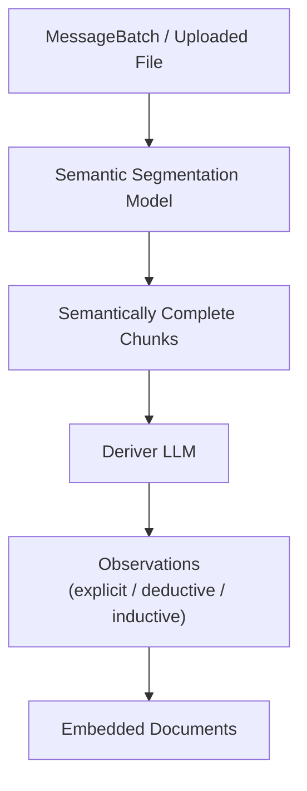
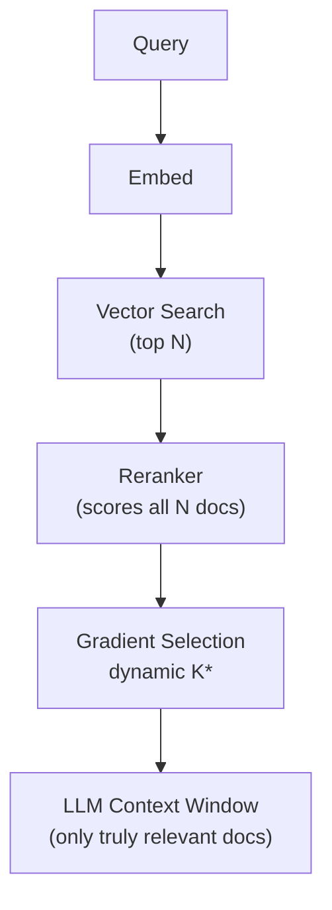
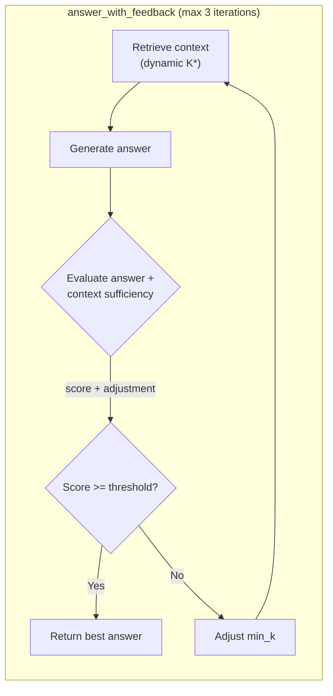
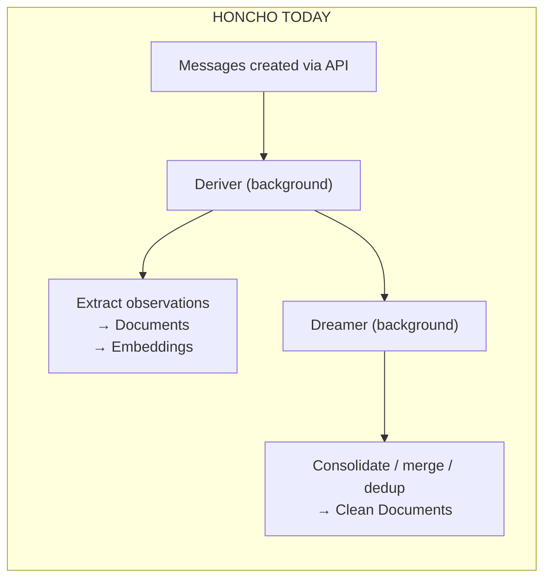
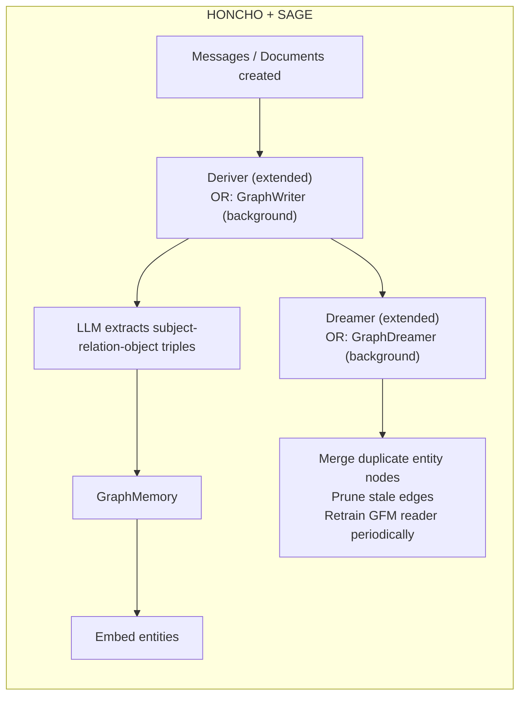

# Honcho-SAGE Integration Plan

**Date:** 2026-05-24
**Source:** Analysis of [SAGE: A Framework of Precise Retrieval for RAG](https://arxiv.org/abs/2503.01713) by Zhang, Li, and Su (2025), applied to Honcho's memory architecture.

---

## Executive Summary

The SAGE framework introduces three core innovations that directly address limitations in Honcho's current memory pipeline:

1. **Semantic Segmentation Model** — Replaces ad-hoc LLM summarization with a trained model that splits text into semantically complete chunks.
2. **Gradient-Based Dynamic Chunk Selection** — Replaces fixed `top_k` retrieval with a relevance-score-based adaptive cutoff.
3. **LLM Self-Feedback Loop** — Adds a post-generation evaluation step where the agent assesses whether retrieved context was sufficient or excessive, then adjusts retrieval parameters dynamically.

These enhancements map cleanly onto Honcho's existing three-stage pipeline (ingest → store → retrieve) and require only incremental architectural changes rather than a full redesign.

---

## Honcho's Current Memory Pipeline

| Stage | Current Behavior |
|-------|---------------|
| **Ingestion** | Messages stored raw in `messages` table. Each message gets one or more `MessageEmbedding` rows (the `chunk_position` field enables multi-part embeddings). |
| **Derivation** | Deriver agent reads message batches, extracts observations (`explicit` / `deductive` / `inductive` / `contradiction`), embeds them, and stores as `Document` rows in per-pair `Collection`s. |
| **Retrieval** | Dialectic uses `search_memory` (HNSW/pgvector), `query_documents_hybrid` (RRF semantic + full-text), optional cross-encoder reranker, then feeds a fixed `top_k` into the LLM. |
| **Consolidation** | Dreamer agent periodically walks documents, merges redundancies, and updates peer cards. |

### Current Limitations (Matching SAGE's Observations)

- **L1 — Ineffective Segmentation:** Documents are created by LLM summarization, not segmented at natural semantic boundaries. A sentence like *"I have a cat. He has bright green eyes."* might be split into *"I have a cat."* and *"He has bright green eyes,"* leaving the second chunk semantically orphaned.
- **L2 — Noisy & Missing Retrieval:** Retrieval uses a fixed `top_k` value. A simple query may retrieve too many irrelevant documents, while a complex query may miss critical context if `top_k` is set too conservatively.
- **No Self-Feedback:** The Dialectic generates an answer in a single pass. There is no mechanism for the agent to evaluate whether its retrieved context was sufficient, excessive, or noisy.

---

## Integration Plan

### 1. Semantic Segmentation Model

#### What It Does

Instead of relying on the Deriver LLM to produce "short atomic facts" from long content, SAGE's segmentation model is a lightweight token-level classifier (e.g., DeBERTa or RoBERTa) that identifies semantic boundaries between sentences. Chunks are guaranteed to be **the smallest semantically complete unit** — no orphaned pronouns, no half-finished thoughts.

#### What Would Change

| Component | File(s) | Change |
|-----------|---------|--------|
| **Deriver prompt** | `src/deriver/prompts.py` | Currently instructs the LLM to produce 10–20 short atomic facts and truncate if too long. This is *implicit* semantic chunking via LLM. The prompt would be updated to instruct the LLM to respect segmentation boundaries or to offload segmentation to the dedicated model. |
| **Document creation** | `src/crud/representation.py` | Currently creates one `Document` per observation. With segmentation, a single long message or uploaded document would first be segmented, then each segment fed into the Deriver for fact extraction. |

#### What Would Be Added

| Component | File(s) | Description |
|-----------|---------|-------------|
| **Segmentation Model** | New: `src/segmentation/` or external service | A fast local model (DeBERTa-based classifier) or microservice endpoint. SAGE reports this costs **< $0.01** and **~2 minutes** per 1M tokens (vs. GPT-4's ~$90 and ~8 hours). |
| **Schema additions** | `src/models.py`, `src/schemas/internal.py` | New fields on `Document`:<br>- `is_semantically_complete` — boolean flag for downstream filtering<br>- `segmentation_boundary_score` — confidence of semantic completeness<br>- `segmentation_source` — `"llm_derived"`, `"model_segmented"`, etc. |
| **Message segmentation** | `src/utils/files.py` | Uploaded documents (PDFs, text files) would be segmented before embedding instead of chunked by fixed character count. |

#### Where It Plugs In



#### For Agent Relevance

When an agent ingests a long user monologue or uploaded document, segmentation ensures each memory atom is self-contained. A retriever searching for *"cat eyes"* will not match *`"He has bright green"`* orphaned from *`"I have a cat. He has..."`*.

---

### 2. Gradient-Based Dynamic Chunk Selection

#### What It Does

After retrieving a candidate set of documents via vector similarity and reranking them, SAGE computes the **gradient of relevance scores** along the sorted list. The retrieval cutoff is placed at the point where scores drop sharply — only the "relevance cliff" matters. This eliminates noisy, low-relevance chunks while preserving all meaningful ones.

The algorithm (adapted from SAGE Algorithm 2):

```python
# After reranker scores documents
scores = [doc.score for doc in reranked_docs]  # descending order

# Always keep at least min_k guaranteed chunks
selected = docs[:min_k]

# For remaining chunks, include only if score remains within threshold
for i in range(min_k, len(scores)):
    if scores[i] > scores[i - 1] / gradient_threshold:
        selected.append(docs[i])
    else:
        break  # reject this and all lower-ranked chunks

return selected
```

#### What Would Change

| Component | File(s) | Change |
|-----------|---------|--------|
| **Document query** | `src/crud/document.py:query_documents()` | Currently does `top_k=N` via cosine distance, then optionally reranks and returns `top_k=settings.RERANKER.TOP_K`. The cutoff is arbitrary and fixed. |
| **Agent search** | `src/utils/agent_tools.py:search_memory()` | Returns a fixed-count result set to the Dialectic agent. Would need to support dynamic counts and expose score metadata. |
| **Prefetching** | `src/dialectic/core.py:_prefetch_relevant_observations()` | Currently fetches 25 explicit + 25 derived regardless of query complexity. Would adapt dynamically. |

#### What Would Be Added

| Component | File(s) | Description |
|-----------|---------|-------------|
| **Gradient analysis** | `src/crud/document.py` | New function `gradient_select()` that takes reranked docs and returns the adaptive cutoff using the score-drop detection algorithm. |
| **Config fields** | `src/config.py` | New fields in `DialecticSettings` / `RERANKER` config:<br>- `GRADIENT_THRESHOLD` (e.g., `2.0` — score must stay within 2× of previous)<br>- `MIN_K` — guaranteed minimum retrieval count<br>- `MAX_K` — hard ceiling to prevent runaway context |

#### Where It Plugs In



#### For Agent Relevance

A simple query like *"What's my name?"* might retrieve just 2–3 highly relevant documents. A complex query like *"What do I believe about AI safety based on our last 6 months of conversations?"* would naturally expand to 15–20. No manual `K` tuning per query.

---

### 3. LLM Self-Feedback Loop

#### What It Does

After generating an answer, SAGE sends a **feedback prompt** to an LLM containing:
- The original question
- The retrieved chunks
- The generated answer

The LLM evaluates:
1. **Answer quality score** (1–10)
2. **Context sufficiency** (`-1` = excessive/noisy, `+1` = insufficient, `0` = adequate)

If the score is below a threshold (e.g., 9), the system adjusts `min_k` and re-runs retrieval and generation (max 3 iterations).

SAGE's feedback prompt template:

```
Objective: Evaluate the original answer for accuracy and reasonability.
Also determine if the original prompt needs more related context (1) 
or less context (-1).

Response format:
Evaluation Score: [1-10]. (The answer is highly accurate if Score >= 9.)
Context Adjustment: [1, -1].
```

#### What Would Change

| Component | File(s) | Change |
|-----------|---------|--------|
| **Dialectic flow** | `src/dialectic/core.py:DialecticAgent.answer()` | Currently a single-pass tool-usage loop or single LLM call with prefetched context. It generates an answer and returns it with no quality evaluation. |
| **Dialectic prompts** | `src/dialectic/prompts.py` | Need to add a new self-evaluation prompt template. |

#### What Would Be Added

| Component | File(s) | Description |
|-----------|---------|-------------|
| **Feedback evaluator** | `src/dialectic/core.py` | New async method `evaluate_answer_quality()` that sends the feedback prompt to an LLM (could be a cheaper model like GPT-4o-mini for cost efficiency). |
| **Adaptive retrieval loop** | `src/dialectic/core.py` | New method `answer_with_feedback()` that wraps the existing `answer()` in a retry loop with `min_k` adjustment based on feedback. |

#### Where It Plugs In



#### For Agent Relevance

The agent can detect when its own answer is hallucinating due to missing context, or when it's drowning in noise. It self-corrects its memory retrieval parameters per-query, improving both accuracy and cost-efficiency.

---

## Specific File and Module Changes

| Component | File(s) | Change Type | Description |
|-----------|---------|-------------|-------------|
| **Segmentation Model** | New: `src/segmentation/` or external service | **Add** | Fast local model for boundary detection. Could be a FastAPI service wrapping a HuggingFace model or an Ollama endpoint. |
| **Segmentation Pipeline** | `src/deriver/deriver.py`, `src/utils/files.py` | **Modify** | Call segmentation before deriver/file upload embedding. Uploaded files currently split by fixed `max_chars`; replace with semantic segmentation. |
| **Document Schema** | `src/models.py`, `src/schemas/internal.py` | **Modify** | Add `is_semantically_complete`, `segmentation_boundary_score`, `segmentation_source` fields to `Document` and `DocumentCreate`. |
| **Dynamic Retrieval** | `src/crud/document.py:query_documents()` | **Modify** | Replace fixed `top_k` with gradient-based selection after reranking. The reranker already returns scores; we just need to use them for cutoff detection. |
| **Agent Tools** | `src/utils/agent_tools.py:search_memory()` | **Modify** | Support `min_k`/`max_k` parameters and return score metadata to enable dynamic downstream selection. |
| **Dialectic Core** | `src/dialectic/core.py` | **Modify** | Add self-feedback evaluation loop between generation and return. Split `answer()` into `answer()` plus `evaluate_and_adjust()`. |
| **Dialectic Prompts** | `src/dialectic/prompts.py` | **Add** | New feedback/evaluation prompt template (similar to SAGE's Figure 6). |
| **Configuration** | `src/config.py` | **Modify** | Add new settings groups or fields:<br>- `SEGMENTATION.MODEL`, `SEGMENTATION.ENDPOINT`<br>- `GRADIENT_THRESHOLD`, `MIN_K`, `MAX_K`<br>- `FEEDBACK_SCORE_THRESHOLD`, `FEEDBACK_MAX_ITERATIONS` |
| **Reranker Client** | `src/reranker_client.py` | **Modify** | Return full scores alongside sorted documents so gradient analysis can use them. Currently returns docs only. |

---

---

## API and Client SDK Impact

The changes required for SAGE integration depend heavily on **which SAGE** is adopted. The RAG-SAGE requires nearly zero API changes (it's a transparent pipeline upgrade), while the Graph-Memory SAGE would need new endpoints, query paradigms, and data models.

### Scenario A: RAG SAGE (Zhang et al., 2503.01713) — Transparent Upgrades

This integration is **backward-compatible and mostly transparent**. Existing client code continues to work with better results.

#### What Stays the Same

| Current API | Behavior After Integration |
|-------------|----------------------------|
| `POST /peers/{peer_id}/chat` | Same endpoint, same params — but retrieval adapts dynamically per-query |
| `POST /peers/{peer_id}/representation` | Same endpoint — but observations are semantically complete |
| `POST /messages` (batch create) | Same endpoint — but documents are automatically segmented |
| File upload (`/messages/upload`) | Same endpoint — but chunks respect semantic boundaries |

#### Minimal New Options

The `DialecticOptions` schema might gain optional tuning parameters:

```python
class DialecticOptions(BaseModel):
    query: str
    stream: bool = False
    reasoning_level: ReasoningLevel = "low"
    # NEW optional SAGE overrides:
    retrieval_mode: Literal["fixed", "adaptive"] = "adaptive"
    self_feedback: bool = False          # enable LLM quality evaluation
    max_feedback_iterations: int = 3
    min_k: int | None = None           # override global config
```

#### SDK Changes

```typescript
// Before (works unchanged)
const response = await honcho.chat({
  query: "What do I believe about AI safety?",
  reasoning_level: "high"
});

// NEW: Optional explicit adaptive retrieval
const response = await honcho.chat({
  query: "What do I believe about AI safety?",
  reasoning_level: "high",
  retrieval_mode: "adaptive",  // gradient-based K selection
  self_feedback: true          // LLM evaluates and re-queries
});
```

#### No Schema Changes for Clients

The `Document` → `Embedding` → `Collection` model stays the same. The segmentation metadata (`is_semantically_complete`, `segmentation_boundary_score`) is server-side internal state.

---

### Scenario B: Graph-Memory SAGE (Wang et al., 2605.12061) — New Paradigm

This requires **new API surface, new query concepts, and potentially SDK rewrites**.

#### New API Endpoints

**1. Graph Query Endpoint**

```http
POST /v3/workspaces/{workspace_name}/peers/{peer_id}/graph/query
```

With body:

```json
{
  "query": "How does HippoRAG relate to GraphRAG?",
  "query_plan": null,
  "mode": "hybrid",
  "top_k_documents": 5,
  "top_k_entities": 20,
  "soft_address_temp": 1.0,
  "selector_threshold": 0.5
}
```

Response:

```json
{
  "answer": "HippoRAG is inspired by the hippocampus...",
  "retrieved_documents": [...],
  "activated_entities": ["hippocampus", "hipporag", "graphrag"],
  "subgraph": {
    "nodes": [...],
    "edges": [...],
    "selection_probs": [...]
  },
  "query_plan": {
    "explicit_entities": ["hipporag", "graphrag"],
    "relation_clues": ["inspired_by", "related_to"],
    "pseudo_queries": [...]
  }
}
```

**2. Graph Inspection**

```http
GET /v3/workspaces/{workspace_name}/peers/{peer_id}/graph
```

Returns the current heterogeneous graph:

```json
{
  "entities": [
    {"id": 0, "name": "hippocampus", "static_features_dim": 64},
    {"id": 1, "name": "hipporag", "static_features_dim": 64}
  ],
  "relations": [
    {"src": 1, "dst": 0, "relation": "inspired_by"}
  ],
  "documents": [
    {"id": 0, "text": "HippoRAG builds on..."}
  ],
  "entity_doc_edges": [...]
}
```

**3. Direct Triple Insertion**

```http
POST /v3/workspaces/{workspace_name}/peers/{peer_id}/graph/triples
```

```json
{
  "triples": [
    {"subject": "SAGE", "relation": "builds_on", "object": "graphrag"}
  ],
  "source_document_id": "doc-abc123"
}
```

#### Changes to Existing Endpoints

**Messages: Trigger Triple Extraction**

The message creation endpoint gains a flag to trigger graph extraction:

```json
POST /v3/workspaces/{ws}/sessions/{sess}/messages

{
  "messages": [...],
  "extract_triples": true,
  "writer_policy": "default"
}
```

**File Upload: Graph Mode**

```json
POST /v3/workspaces/{ws}/sessions/{sess}/messages/upload

--form-data--
file: document.pdf
peer_id: user
graph_extraction: true
```

**Chat: Graph-Aware Query**

```json
POST /v3/workspaces/{ws}/peers/{peer_id}/chat

{
  "query": "What did I say about hippocampal memory?",
  "mode": "graph",
  "graph_params": {
    "top_k_entities": 20,
    "selector_threshold": 0.5
  }
}
```

#### New Schema / Data Models

| Server-side Model | Client Relevance |
|-------------------|------------------|
| `GraphMemory` | New — peer has a graph alongside documents |
| `Triple` (`subject`, `relation`, `object`) | New — structured fact representation |
| `QueryPlan` (extractor + inferer output) | New — structured retrieval signals |
| `Entity` + `Relation` | New — graph node/edge types |

#### SDK Changes (TypeScript Example)

```typescript
// BEFORE: Vector-only retrieval
const response = await honcho.chat({
  query: "What do I believe about AI safety?"
});

// AFTER: Graph-aware retrieval
const response = await honcho.chat({
  query: "What do I believe about AI safety?",
  mode: "hybrid"  // or "graph", "semantic", "naive"
});

// NEW: Direct graph query
const graphResult = await honcho.graph.query({
  peer_id: "user",
  query: "How does HippoRAG relate to GraphRAG?",
  mode: "hybrid"
});

// NEW: Inspect the graph
const graph = await honcho.graph.get({ peer_id: "user" });
console.log(graph.entities);
console.log(graph.relations);

// NEW: Add triples directly
await honcho.graph.addTriples({
  peer_id: "user",
  triples: [
    {subject: "SAGE", relation: "builds_on", object: "GraphRAG"}
  ]
});
```

#### New Query Paradigms

Graph-Memory SAGE introduces **structured query planning** (§App-K.2) that the current Honcho API has no equivalent for:

| Query Type | Current | With Graph SAGE |
|------------|---------|-----------------|
| **Entity lookup** | Semantic search over observations | Soft-addressing via explicit entities + aliases |
| **Multi-hop reasoning** | Not supported (flat document list) | GNN propagation along graph edges |
| **Relation-aware** | Not supported | Query structured by relation clues (`inspired_by`, `builds_on`) |
| **Type constraints** | Not supported | Hard constraints on answer type (`τ`) |
| **Pseudo-queries** | Not supported | LLM generates exploratory sub-queries (`q̃_m`) |

---

#### Client Impact Matrix

| Change | RAG SAGE (2503.01713) | Graph-Memory SAGE (2605.12061) |
|--------|-----------------------|-------------------------------|
| **New endpoints** | 0 | 3 (`/graph/query`, `/graph`, `/graph/triples`) |
| **Modified endpoints** | 1 (`/chat` — optional params) | 4 (chat, messages, upload, representation) |
| **Schema changes** | Internal only (`Document` fields) | New types: `GraphMemory`, `Triple`, `QueryPlan`, `Entity` |
| **SDK changes** | Optional (new chat params) | Major (new `honcho.graph.*` namespace) |
| **Migration effort** | None (transparent upgrade) | High (new query paradigm, new data model) |
| **Backward compatibility** | ✅ Full | ⚠️ Chat stays compatible; new features require opt-in |

---

## Architectural Considerations

### Why This Fits Cleanly

- **Collection → Document → Embedding** model already exists. Semantic segmentation just means creating higher-quality documents at ingest time.
- **Dialectic already uses tools** for iterative context gathering. Self-feedback is an extension of that agentic loop.
- **Reranker client already exists** but only sorts. Adding gradient analysis is a ~50-line change to that module.

### Risks & Mitigations

| Risk | Impact | Mitigation |
|------|--------|------------|
| **Cost** | Self-feedback adds 1–3 extra LLM calls per query. | Conditionally enable only when `reasoning_level` is `"high"`. Use GPT-4o-mini or local models for evaluation. SAGE shows total cost *decreases* because fewer noisy tokens reach the generation stage. |
| **Latency** | Extra retrieval/generation loops add latency. | Parallelize feedback evaluation with streaming response generation. Or use a cheaper model for evaluation. Limit to max 3 iterations. |
| **Token limits** | Deriver already has `max_embedding_tokens` constraints. | Segmentation model must respect same limits — each output chunk must fit within the embedding context window. |
| **Backward compatibility** | Documents created before segmentation lack new fields. | Grandfather existing documents or re-process them via the Dreamer. `is_semantically_complete` defaults to `NULL` for legacy docs. |

---

## Bottom Line

SAGE maps cleanly onto Honcho because both systems share the same three-stage pipeline: **ingest → store → retrieve**. The proposed changes are incremental enhancements rather than architectural overhauls:

1. **Segmentation** replaces ad-hoc LLM summarization with a trained model guaranteeing semantic completeness of each memory chunk.
2. **Gradient selection** upgrades the existing reranker from "return top K" to "return precisely the relevant ones."
3. **Self-feedback** turns the Dialectic from a single-shot retriever into an adaptive retrieval agent that evaluates its own sufficiency.

The biggest implementation lift is training/hosting the segmentation model — but SAGE reports this is orders of magnitude cheaper than LLM-based alternatives. The remaining changes (gradient analysis, feedback loop) are wiring logic that Honcho's existing agentic architecture already supports.


---

## Appendix A: A Second SAGE System — Self-Evolving Agentic Graph-Memory (Wang et al., 2026)

**Note (2026-05-24):** During follow-up research, a second SAGE codebase was discovered at `~/workspace/sage_self_evolving_graph_memory/`. This implements an entirely different SAGE paper:

> **SAGE: A Self-Evolving Agentic Graph-Memory Engine for Structure-Aware Associative Memory**  
> Wang, Juntong, et al. (NeurIPS 2026) — arXiv:2605.12061

This appendix documents its graph construction methodology for completeness and to prevent confusion with the RAG-focused SAGE (Zhang et al., 2025) discussed in the main body.

### How This SAGE Builds Its Knowledge Graph

Unlike the RAG SAGE (which operates on text chunks), the graph-memory SAGE maintains a **heterogeneous text-graph** $G = (V_e \cup V_d, E_{ee} \cup E_{ed})$ stored entirely as **in-memory PyTorch tensors** (no graph database).

| Component | Description |
|-----------|-------------|
| **$V_e$ — Entity Nodes** | Deduplicated subjects and objects extracted from triples by an LLM writer policy |
| **$V_d$ — Document Nodes** | Raw document texts serving as sources |
| **$E_{ee}$ — Entity-Entity Edges** | Each `(subject, relation, object)` triple → one directed edge |
| **$E_{ed}$ — Entity-Document Edges** | Both endpoints of a triple linked to the document it originated from |

### Construction Pipeline

1. **LLM Writer Extracts Triples (§App-O.1)** — An LLM (GPT-4o-mini or equivalent) reads documents one per turn in a multi-turn MDP and outputs JSON arrays of `(subject, relation, object)` triples.

2. **Strict Cleaning** — Raw LLM output is parsed with `json_repair`. Non-dictionary entries, missing keys, empty strings, or malformed triples are dropped. Unparseable JSON is treated as an illegal action (immediate termination, zero reward).

3. **MDP Accumulation** — Cleaned triples are appended to a `WriterState` along with their source document indices:
   ```python
   state.triples.extend(triples)
   state.triple_sources.extend([current_doc] * len(triples))
   ```

4. **Graph Assembly** — `GraphMemory.from_triples()` deduplicates entity strings, builds the edge index tensor, and constructs an $n \times ND$ incidence matrix linking entities to documents.

### Key Architectural Facts

- **No graph database** — The entire graph is a Python `@dataclass` holding PyTorch tensors (`entity_edge_index`, `entity_doc_matrix`, `node_static_features`).
- **Self-evolving** — The writer policy is trained via GRPO (Group Relative Policy Optimization), where rewards come from a frozen **Graph Foundation Model (GFM) reader** that queries the graph. Better triple extraction → better retrieval → higher reward.
- **In-memory only** — There is no persistence layer, no Cypher/Gremlin, and no Neo4j/ArangoDB/DGL dependency. The `requirements.txt` only lists `torch`, `pyyaml`, and `python-dotenv`.

### Relevance to Honcho

If Honcho were to integrate this graph-memory SAGE, the changes would be substantially different from the RAG-SAGE integration plan above:

- **New pipeline stage**: Replace or augment the Deriver's observation-extraction with an LLM triple-extraction step
- **Schema changes**: Add `triples`, `relation_names`, and `entity_doc_matrix` alongside or instead of vector `Document` embeddings
- **Reader architecture**: Replace semantic similarity search with a Gated Graph Neural Network (GatedGNN) that propagates activation through the graph structure
- **No vector DB required for graph edges** — though entity/document embeddings are still used for initialization

### Distinguishing the Two SAGE Papers

| Aspect | SAGE RAG (Zhang et al., 2025) | SAGE Graph-Memory (Wang et al., 2026) |
|--------|--------------------------------|----------------------------------------|
| **arXiv** | 2503.01713 | 2605.12061 |
| **Core data** | Text chunks (semantically segmented) | Triples $(s, r, o)$ in heterogeneous graph |
| **Storage** | Vector database (pgvector/HNSW) | In-memory PyTorch tensors |
| **Retrieval** | Semantic similarity + gradient selection | Graph propagation via GatedGNN + soft addressing |
| **Training** | Segmentation model (cheap, local) | GRPO on LLM writer + GraphCL/SFT on GFM reader |
| **Cost** | \< $0.01 / 1M tokens | Requires live LLM + GNN training (expensive) |

### Should a Background Process Optimize the Knowledge Graph?

The SAGE paper (2605.12061) is an **offline system**, not a live service. The published training pipeline runs sequentially:

1. **Dataset → Triples → Graph** — one-pass LLM writer on a static corpus
2. **Reader Pretraining** — GraphCL on the fixed graph
3. **Reader Fine-Tuning** — supervised QA training
4. **Writer GRPO Training** — policy improved against a frozen reader using held-out queries

There is no daemon, queue, or continuous optimization loop. The "self-evolving" in the title refers to **policy improvement through RL**, not background graph maintenance.

However, if SAGE were deployed as an online memory system (e.g., integrated into Honcho), **background processes would be essential**.

#### Required Background Tasks for Online SAGE

| Background Task | What It Would Do | Honcho Parallel |
|-----------------|-------------------|----------------|
| **Triple Extraction Worker** | Process incoming documents/messages and extract `(s, r, o)` triples via the LLM writer | Deriver agent |
| **Graph Consolidation** | Merge duplicate entities, resolve aliases, prune obsolete triples, compress redundancy | Dreamer agent |
| **Reader Warmup / Retraining** | Re-finetune or adapt the GFM reader as the graph structure changes | Not currently in Honcho |
| **Writer Policy Update** | Periodically retrain the writer via GRPO using accumulated feedback data | Not currently in Honcho |

#### Mapping onto Honcho's Existing Architecture

Honcho already has a three-tier background system that maps almost directly:





#### Specific Integration Points

**1. Extended Deriver: The GraphWriter**

The existing deriver (`src/deriver/agent/`) already consumes message batches from a queue. It could be extended to:

- Prompt an LLM to extract structured triples in addition to (or instead of) free-text observations
- Call `GraphMemory.from_triples()` to incrementally build the graph
- Store triples in a new table/collection for later graph reconstruction

**2. Extended Dreamer: The GraphOptimizer**

The dreamer (`src/dreamer/agent.py`) already does periodic memory consolidation. It could be extended to:

- Walk the graph and **identify duplicate entities** (e.g., nodes connected by `alias_of`)
- **Prune low-relevance edges** using the GFM reader's scoring as a signal
- **Merge redundant subgraphs** — clusters of triples expressing the same relationship
- **Update entity static features** (`x_e`) as new documents are added

**3. Writer Policy Updates: Batch vs. Online**

GRPO training of the writer is expensive. Options for real-time deployment:

| Approach | Pros | Cons |
|----------|------|------|
| **Batch retraining** (nightly/weekly) | Predictable cost, reuses accumulated feedback | Writer/policy can get stale between updates |
| **Online RL with small batch updates** | More responsive to new data | Costly, needs careful gradient stability |
| **No retraining — fixed policy** | Simple and cheap | Loses the "self-evolving" property |

For an initial integration, **batch retraining** (triggered by queue depth or schedule) is most practical. The background task would:
1. Accumulate N new interaction samples since last update
2. Run the `self_evolution` loop
3. Swap in the updated writer weights

---

*References:*
- Zhang, J., Li, G., & Su, J. (2025). *SAGE: A Framework of Precise Retrieval for RAG*. arXiv:2503.01713 [cs.LG].
- Wang, J., Zhao, H., Pan, G., et al. (2026). *SAGE: A Self-Evolving Agentic Graph-Memory Engine for Structure-Aware Associative Memory*. arXiv:2605.12061.
- Honcho Architecture Overview (from project `CLAUDE.md` and source code analysis, 2026-05-24).
- SAGE Graph-Memory codebase analysis (`~/workspace/sage_self_evolving_graph_memory/`), 2026-05-24.

