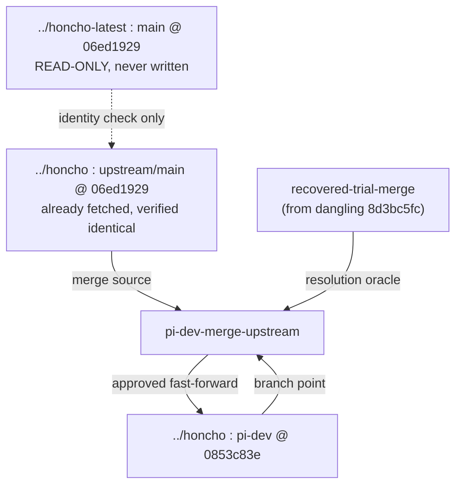

# Requirements

### Overview & Goals

Merge all upstream changes currently represented by `../honcho-latest` branch `main` (commit `06ed1929`) into `../honcho` branch `pi-dev`, **without making any change whatsoever to `../honcho-latest`**.

Yes — that direction makes sense, and it is already how the prior analysis was framed. One clarification that simplifies everything:

> `../honcho-latest:main` @ `06ed1929` is a pristine clone of `plastic-labs/honcho` and is **byte-identical to `../honcho`'s `upstream/main`**, which is already fetched locally.

So `../honcho-latest` is purely a **read-only reference checkout**. The merge is performed entirely inside `../honcho` using its own `upstream/main` ref. `../honcho-latest` is never checked out, never committed to, never pushed from, and no remote is added pointing writes at it. This is the strongest possible guarantee of the "don't change honcho-latest" constraint: we simply never touch that directory.

### Scope

**In scope**
- Written merge report + phased plan committed to `docs/v3/guides/community/dgs-integrations/`.
- Preservation of the already-validated trial-merge work currently surviving only as dangling git objects.
- Execution of the real merge on a dedicated branch `pi-dev-merge-upstream` in `../honcho`.
- The five known semantic repairs, the single Alembic re-parent, dependency re-sync, and test-suite green-up.

**Out of scope**
- Any write to `../honcho-latest` (no commits, no branches, no fetch-from, no push-to).
- Any force-push or rewrite of `origin/pi-dev`.
- Fast-forwarding `pi-dev` itself until the merge branch is validated and you approve.
- Resolving the pre-existing retry-escalation work (`src/deriver/error_tracker.py`, `queue_manager.py`) — it must simply be committed or stashed first, not redesigned.

### Functional Requirements

1. `../honcho-latest` has identical `git status` / `git rev-parse HEAD` before and after the entire operation.
2. A branch `pi-dev-merge-upstream` exists in `../honcho` containing a merge commit with parents `pi-dev` tip and `upstream/main` (`06ed1929`).
3. `alembic heads` reports exactly **one** head on the merged tree.
4. `uv run python -c "import src.main"` succeeds and the FastAPI app enumerates its full route set.
5. All pi-dev-only assets survive: `query_documents_hybrid`, `DocumentSearch`, `SynthesisSpecialist`, `reranker_client.py`, `middleware/ip_filter`, `src/honcho_pi/*`, hybrid-search migration.
6. Test suites run and every remaining failure is either fixed or explicitly classified.
7. `pi-dev` is only advanced after explicit approval.

### Non-Functional Requirements
- Every step is reversible: the merge lives on its own branch; `pi-dev` is reachable by `git checkout pi-dev` at any moment.
- No `git gc` / `git worktree prune` is run until the dangling trial commits are branch-anchored.

# Technical Design

### Current Implementation

| Repo | Branch | Commit | State |
|---|---|---|---|
| `/home/dsidlo/workspace/honcho` | `pi-dev` | `0853c83e` | 10 ahead of `origin/pi-dev`, 8 modified files, untracked items |
| `/home/dsidlo/workspace/honcho-latest` | `main` | `06ed1929` | clean, in sync — **read-only reference** |

- Merge base: `b3c1917` ("Fix typos #440").
- `git rev-list --count pi-dev..upstream/main` = **306**; `upstream/main..pi-dev` = **27**.
- Conflict surface (validated twice in isolated `/tmp` worktrees): **28 files, ~200 hunks**. Heaviest: `uv.lock` (92 — regenerate, never hand-merge), `tests/conftest.py` (14), `src/deriver/queue_manager.py` (13), `src/embedding_client.py` (11), `src/crud/representation.py` (10), `src/config.py` (9).
- Two prunable worktree registrations (`/tmp/honcho-r6`, `/tmp/honcho-conflict-check`) point at deleted directories.

### Key Decisions

1. **`../honcho-latest` is never written to.** The merge source is `../honcho`'s local `upstream/main` ref, proven identical to `honcho-latest:main`. We verify that identity once (`git rev-parse`) and then work exclusively inside `../honcho`.
2. **Merge onto a new branch, not `pi-dev`.** `pi-dev-merge-upstream` branches from `pi-dev`; `pi-dev` moves only by an explicit, approved fast-forward at the end.
3. **Reuse the validated resolution, don't redo it.** Dangling commit `8d3bc5fc` is the merge *with all five repairs applied and runtime-validated*. It is anchored to a branch and used as the resolution oracle.
4. **One-shot merge to `upstream/main`, not staged.** Staging by release tag only reduces 28 → 24 conflicted files; the core ~20 conflict regardless. Staging buys bisectability at the cost of 6 extra merge commits.
5. **`uv.lock` is regenerated, not merged.** Take upstream `pyproject.toml` wholesale, then `uv lock` / `uv sync`.
6. **Embedding dims become config, not code.** Upstream makes the pgvector dimension configurable, so the Ollama `qwen3-embedding:8b` path is reached via `EMBEDDING__MODEL_CONFIG__MODEL` + `OVERRIDES__BASE_URL` env vars rather than the fork's custom client.

### The five known repairs (all already proven in the trial)

| # | Area | Repair |
|---|---|---|
| 1 | `SynthesisSpecialist` | Register in upstream's `SPECIALISTS` dict; implement `get_model_config() -> ConfiguredModelSettings`; align `build_user_prompt(observed, hints, peer_card)`; fix `self.observed` → `observed`. |
| 2 | `query_documents_hybrid` + `DocumentSearch` | Re-add the 397-line function to `src/crud/document.py` and the schema to `src/schemas/api.py`; they are referenced by auto-merged `src/crud/__init__.py` and `src/routers/workspaces.py`. Also restore the `RERANKER` settings block. |
| 3 | Alembic | Re-parent `adb68784e753` from `f1a2b3c4d5e6` to `b8d2f4a6c9e1` → single head, 27–28 migrations. |
| 4 | `src/telemetry/emitter.py` | Auto-merges cleanly but keeps `cloudevents.v1.*` imports against upstream's `<2.0` pin → switch to the flat module layout. |
| 5 | `middleware/ip_filter` | `raise HTTPException(403)` inside `BaseHTTPMiddleware` surfaces as 500 → `return JSONResponse(status_code=403, ...)`. |

### Architecture Diagram



### Risks

- **`git gc` destroys the trial work.** Mitigated by anchoring `8d3bc5fc` (and `6b6beb00`, `f4d140fa`, `806e9962`, `597d6ca9`, `1d7536c0`) to branches/tags *before* any prune.
- **Dirty working tree at merge time.** 8 modified files must be committed or stashed; `git merge` will refuse otherwise.
- **Trial commits are based on `07fbd682`, `pi-dev` is now `0853c83e`** (+2 docs-only commits on the retry-escalation plan) — the resolution ports forward cheaply.
- **Existing padded 1536-dim vector rows** remain under the old padding scheme after the dimension becomes configurable; a re-embed is a separate, later decision.
- **Test residuals**: 6 `routes` + 1 `integration` failure in the trial were classified as trial-artifacts (merged tree pairing one parent's tests with the other's `src`). On a real merge they should disappear; any that persist are genuine and must be fixed.

# Testing

### Validation Approach

Three gates, in order. Each gate must pass before the next begins.

**Gate A — isolation invariant (runs first and last)**
```
cd ../honcho-latest && git rev-parse HEAD && git status --porcelain
```
Must print `06ed1929…` and empty output, identically before and after. Recorded in the report.

**Gate B — structural**
- `uv sync` then `uv run alembic heads` → exactly one head.
- `uv run alembic upgrade head` against a disposable `pgvector/pgvector:pg18` container (`POSTGRES_HOST_AUTH_METHOD=trust`), then `downgrade b8d2f4a6c9e1`, then `upgrade head` again.
- `uv run ruff check src/` and `uv run basedpyright`.

**Gate C — behavioral**
- `uv run python -c "import src.main"`; assert the route table includes `/workspaces/{workspace_id}/documents/search`.
- `uv run pytest tests/` top level, then `tests/routes`, `tests/integration`.
- `uv run pytest tests/ -k typescript`.

### Key Scenarios

| Scenario | Expected |
|---|---|
| `POST /workspaces/{id}/documents/search` with `top_k=1000` | 422 (`le=100`) |
| same, missing `observer` | 422 |
| same, invalid `method` literal | 422 |
| same, valid body | reaches `query_documents_hybrid` |
| `SynthesisSpecialist` present in `SPECIALISTS` and `.run()` with mocked LLM | `SpecialistResult(success=True)`, zero cloudevents warnings |
| `/health` via `ip_filter` | 200 (excluded path) |
| disallowed IP | **403** with JSON body, not 500 |
| settings load with `EMBEDDING__MODEL_CONFIG__MODEL=qwen3-embedding:8b`, `OVERRIDES__BASE_URL=http://localhost:11434/v1` | resolves transport `openai`, correct base_url |

### Edge Cases
- Zero stale `src.utils.clients` imports (upstream split it into `src/llm`); grep to confirm.
- `cashews` resolves to upstream's pin (7.5.0) and imports `SafeRedisCluster`.
- `migrations/env.py` retains the two local bootstrap defaults (5433 URI fallback, ollama embedding provider).
- Every pi-dev asset file still present on disk post-merge (explicit existence check list).

### Test Changes
No new test files planned. Any test that genuinely breaks because upstream changed a contract is updated to the upstream contract; any that breaks because a pi-dev feature was dropped is treated as a merge defect and the feature is restored instead.

# Delivery Steps

### ✓ Step 1: Preserve the validated trial-merge work and confirm the read-only invariant
The day's worth of proven conflict resolution is anchored to real refs and can no longer be lost to garbage collection, and the read-only status of `../honcho-latest` is recorded as a baseline.

- In `../honcho`, create `git branch recovered-trial-merge 8d3bc5fc` — the merge with all five repairs applied and runtime-validated.
- Tag the supporting dangling commits so they survive too: `6b6beb00` (TRIAL MERGE base), `f4d140fa` (R6 base merge), `806e9962` (R4 lint cleanup), `597d6ca9` (`HONCHO_TEST_DB_URI` override + TestClient IP handling), `1d7536c0` (cashews `CancelledError` teardown suppression).
- Verify each anchored commit is now reachable (`git branch --contains`, `git fsck` no longer lists them as dangling).
- Only then run `git worktree prune` to clear the two stale `/tmp/honcho-r6` and `/tmp/honcho-conflict-check` registrations.
- Record the Gate A baseline: `cd ../honcho-latest && git rev-parse HEAD && git status --porcelain` → expect `06ed1929…` and empty.
- Verify the identity claim once: `git rev-parse upstream/main` in `../honcho` equals `honcho-latest:main`, establishing that `../honcho-latest` need never be touched again.

### ✓ Step 2: Write the merge report and phased plan into the docs tree
`docs/v3/guides/community/dgs-integrations/` contains the merge deliverable that was requested twice and never written.

- Add `Honcho-Upstream-Merge-Report-and-Plan.md`, following the conventions of the sibling docs (`Honcho-Retry-Escalation-Bug-Fix-Plan.md`, `hybrid-search-report.md`).
- State the direction and constraint explicitly up front: `honcho-latest:main` → `pi-dev`, `honcho-latest` read-only, merge executed via `../honcho`'s own `upstream/main`.
- Document the divergence: merge base `b3c1917`, 306 upstream commits missing, 27 pi-dev-only, missing releases v3.0.12 → v3.2.2.
- Document the conflict surface: 28 files / ~200 hunks with the per-file hunk table, and the finding that staged merging only reduces this to 24.
- Document what upstream brings: `honcho-cli`, `hermes-plugin-honcho`, `harness-plugin-core`, `sandbox/`, `skills/`, dialectic `include_evidence`, conclusion attribution, scope hardening, RRF + pluggable vector stores, Redis stability fixes, the `session_peers` index (28.9ms → 0.15ms), Langfuse exporter rework.
- Document the five repairs with the exact symptom and fix for each.
- Record the verdict (merge is worth doing, mechanically proven) and reference `recovered-trial-merge` as the resolution oracle.

### ✓ Step 3: Create the merge branch and land the 28-file conflict resolution
Branch `pi-dev-merge-upstream` in `../honcho` holds a committed merge of `upstream/main` into `pi-dev` with every conflict resolved.

- Commit or stash the 8 modified working-tree files (`README.md`, `src/config.py`, `src/deriver/error_tracker.py`, `src/deriver/queue_manager.py`, `src/main.py`, the two tests, the hybrid-search doc) so the tree is clean.
- `git checkout -b pi-dev-merge-upstream pi-dev` then `git merge upstream/main`.
- Resolve using the proven matrix, diffing against `recovered-trial-merge` file-by-file: `pyproject.toml` → upstream whole; `uv.lock` → delete and regenerate via `uv lock`; `src/utils/clients.py` → accept upstream's deletion (split into `src/llm`); `migrations/env.py` → upstream plus the two re-spliced local bootstrap defaults; pi-dev-only deltas in upstream-rewritten modules kept where local-only.
- Work through `src/deriver/queue_manager.py` (13 hunks), `src/embedding_client.py` (11), `src/crud/representation.py` (10), `src/config.py` (9), `tests/conftest.py` (14) against the oracle, accounting for the +2 commits `pi-dev` gained since `07fbd682`.
- Commit the merge; confirm `git log -1 --format=%P` shows both parents.

### * Step 4: Apply the five semantic repairs on the merged tree
The merged tree imports cleanly, keeps every pi-dev feature, and has a single Alembic head.

- Restore `query_documents_hybrid` (397 lines) in `src/crud/document.py` and the `DocumentSearch` schema plus its export, which the auto-merged `src/crud/__init__.py` and `src/routers/workspaces.py` already reference.
- Restore the `RERANKER` settings block into upstream's config root.
- Adapt `SynthesisSpecialist` to upstream's `BaseSpecialist`: add `get_model_config() -> ConfiguredModelSettings` using the `_require_specialist_model_config(settings.DREAM.INDUCTION_MODEL_CONFIG, ...)` idiom, align `build_user_prompt(observed, hints, peer_card)`, fix the `self.observed` → `observed` template reference, and register it in the `SPECIALISTS` dict.
- Re-parent Alembic migration `adb68784e753` from `f1a2b3c4d5e6` to `b8d2f4a6c9e1`.
- Switch `src/telemetry/emitter.py` from `cloudevents.v1.*` to upstream's flat imports, matching the `<2.0` pin the merged lockfile resolves.
- Change `middleware/ip_filter`'s deny path from `raise HTTPException(403)` to `return JSONResponse(status_code=403, ...)`.
- Run `uv sync`, then `uv run ruff check src/` and `uv run basedpyright`.

###   Step 5: Validate structurally and behaviorally against a real database
The merge branch passes migration, import, route, and test gates with every residual failure either fixed or explicitly classified.

- Gate B: `uv run alembic heads` → single head; against a disposable `pgvector/pgvector:pg18` container with `POSTGRES_HOST_AUTH_METHOD=trust`, run `upgrade head` → `downgrade b8d2f4a6c9e1` → `upgrade head`.
- Verify schema artifacts: `idx_documents_content_tsv`, `idx_documents_content_trgm`, the HNSW embedding index, the generated `content_tsv` column.
- Gate C: `import src.main`, assert `/workspaces/{workspace_id}/documents/search` is in the route table.
- Run the scenario matrix: `top_k=1000` → 422, missing `observer` → 422, bad `method` → 422, valid body reaches the hybrid function; `/health` → 200, disallowed IP → 403 JSON, allowed IP → 200; `SynthesisSpecialist.run()` with mocked LLM → success with zero cloudevents warnings.
- Confirm the Ollama config path: `EMBEDDING__MODEL_CONFIG__MODEL=qwen3-embedding:8b` + `OVERRIDES__BASE_URL=http://localhost:11434/v1` resolves to the openai transport.
- Run `uv run pytest tests/`, `tests/routes`, `tests/integration`, and `uv run pytest tests/ -k typescript`; fix or classify each failure (the trial's 6 routes + 1 integration failures were trial-artifacts and should not reappear).
- Tear down the container and re-run Gate A on `../honcho-latest` to prove it is byte-identical to the baseline.

###   Step 6: Finalize: update the docs deliverable and hand off the merge decision
The report reflects what actually happened and `pi-dev` advances only on explicit approval.

- Update `Honcho-Upstream-Merge-Report-and-Plan.md` with the real outcome: final conflict count, any deviation from the predicted resolution matrix, the test results table, and the before/after Gate A proof for `../honcho-latest`.
- Note any defects discovered beyond the known five, and any test failures that turned out genuine rather than trial-artifacts.
- Record the post-merge follow-ups that are deliberately deferred: re-embedding the existing padded 1536-dim vector rows under the now-configurable dimension, and the `src/db.py` module-scope `engine` singleton shared across concurrent requests.
- Present `pi-dev-merge-upstream` for review; do not fast-forward `pi-dev` or push to `origin/pi-dev` without explicit approval.
- Leave `recovered-trial-merge` and the trial tags in place as the audit trail.